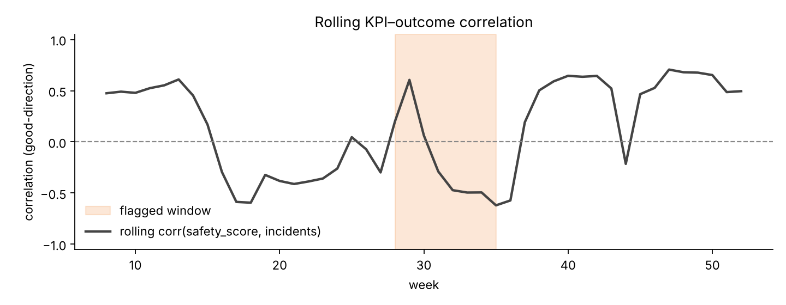
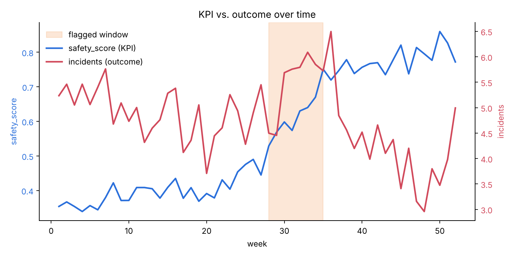

# MetricGuard

[](https://github.com/Mfurlan03/metricguard/actions/workflows/ci.yml)


**MetricGuard detects when KPIs stop representing reality.**

It flags **KPI gaming, metric drift, and KPI–outcome decoupling** in time series using
interpretable, behavior-aware signals, and it comes with a labeled benchmark so its
detection accuracy is measured, not asserted.

> When a measure becomes a target, it ceases to be a good measure. — *Goodhart's Law*

---

## Why MetricGuard exists

Organizations manage performance, safety, and quality through KPIs. Over time those
metrics often fail silently:

- teams optimize the metric, not the outcome
- reporting practices change
- incentives create shortcuts
- dashboards look green while reality worsens

MetricGuard looks for the behavioral fingerprints of those failures and explains *why* it
raised a flag, so an analyst can verify it instead of trusting a black box.

---

## Quickstart

```bash
pip install -e ".[dev]"

# 1. Generate a labeled synthetic dataset (or bring your own CSV)
python -m metricguard generate --scenario safety --mode gamed --out data/safety_gamed.csv

# 2. Analyze it
python -m metricguard run --csv data/safety_gamed.csv \
  --time week --kpi safety_score --outcome incidents \
  --extras near_misses overtime_hours \
  --kpi-higher-better true --outcome-higher-better false \
  --out reports/safety_gamed.md --plot

# 3. Measure detection accuracy
python -m metricguard benchmark --seeds 0:100
```

Or from Python:

```python
import pandas as pd
from metricguard import analyze_kpi_integrity

result = analyze_kpi_integrity(
    pd.read_csv("data/safety_gamed.csv"),
    time_col="week",
    kpi_col="safety_score",
    outcome_col="incidents",
    extra_cols=["near_misses", "overtime_hours"],
    kpi_higher_better=True,
    outcome_higher_better=False,
)
print(result.risk_level, result.risk_score, result.suspicious_window)
```

---

## How it works

Every series is first converted to a "good direction" (higher = better) and scaled by its
own step-to-step noise (robust MAD of first differences). That makes every signal
**unit-invariant**: a 0–1 safety score and a count of hundreds of tickets are judged on the
same footing.

| Signal | What it captures |
|---|---|
| Correlation decay | KPI–outcome rolling correlation weakens from the start to the end of the series |
| Correlation instability | Frequent sign flips in the rolling correlation |
| Drift gap | KPI changes are far more volatile than outcome changes (possible inflation) |
| Suspicious window | The window where the KPI improves *faster than its own trend* while the outcome deteriorates *faster than its own trend* |
| Contradictions | Related "cost" signals (overtime, reopens, near-misses) worsen beyond their normal trend inside that window |

The signals are combined into a 0–1 risk score with fixed weights and bucketed into
`LOW / MODERATE / HIGH / CRITICAL`. Every flag comes with a plain-language finding.

---

## Benchmark: how well does it detect gaming?

`python -m metricguard benchmark` generates many seeded series where the ground truth is
known (clean vs. gamed, plus the exact gaming window) and scores the detector on them.

**Protocol.** The two calibration constants (`WINDOW_SCORE_SCALE`, `CONTRADICTION_Z`) were tuned
by grid search on **calibration seeds 1000–1059 only**. The numbers below are on
**seeds 0–99**, which were never used for tuning. "Detection" = risk score ≥ 0.50 (HIGH or CRITICAL).

| Scenario | ROC-AUC | Detection rate | False-positive rate | Window IoU |
|---|---:|---:|---:|---:|
| Safety | 0.960 | 86% | 0% | 0.61 |
| Productivity | 1.000 | 100% | 0% | 0.50 |

**Sensitivity to gaming intensity** (1.0 = default effect size, 0.25 = a quarter of it):

| Intensity | Safety AUC | Safety detection | Productivity AUC | Productivity detection |
|---:|---:|---:|---:|---:|
| 0.25 | 0.549 | 2% | 0.762 | 22% |
| 0.50 | 0.705 | 21% | 0.924 | 79% |
| 0.75 | 0.848 | 51% | 0.986 | 96% |
| 1.00 | 0.960 | 86% | 1.000 | 100% |

Full output: [`docs/benchmark.md`](docs/benchmark.md).

### What the benchmark caught

Building the benchmark exposed a real bug in v0.2. The suspicious-window score was computed
in **raw units**, so any KPI measured in large numbers (e.g. tickets closed) saturated it,
and contradictions were checked against whole-series trends. On clean productivity data
**every series was flagged HIGH risk** (ROC-AUC 0.49, false-positive rate 100%).

| Version | Safety AUC | Safety FPR | Productivity AUC | Productivity FPR |
|---|---:|---:|---:|---:|
| v0.2 | 0.985 | 9% | 0.490 | 100% |
| v0.3 | 0.960 | 0% | 1.000 | 0% |

v0.3 fixes this with noise-scaled, trend-adjusted slopes and window-local contradiction
checks. A regression test (`test_clean_data_is_not_flagged_high`) keeps it fixed.

### Known limitations

- **Subtle gaming is hard.** At 25% intensity, safety-score gaming is close to undetectable.
  That is expected: the inflated signal is smaller than the noise.
- **Window localization is capped by the fixed window length.** The detector scans fixed
  8-period windows, while true gaming windows are 13–15 periods long, so IoU tops out near
  0.5–0.6. An adaptive window (e.g. change-point detection) would improve this.
- **Synthetic ground truth.** The scenarios encode one family of gaming patterns. Real KPI
  gaming can look different, so treat the benchmark as a sanity check rather than proof of
  real-world accuracy.

---

## Example: KPI gaming in safety metrics

In this synthetic safety scenario the safety KPI keeps improving, incidents worsen during a
localized period, and overtime and near-misses climb as teams optimize the metric.
MetricGuard rates it **HIGH risk** and points to the failure window.

### Rolling KPI–outcome relationship

<p align="center">
  
</p>

### Identified KPI gaming window

<p align="center">
  
</p>

---

## Development

```bash
pip install -e ".[dev]"
ruff check . && ruff format --check .
pytest -q
```

CI runs lint, the test suite (30 tests), and a reduced benchmark on Python 3.10–3.12 for every push and PR.

## Project layout

```
metricguard/
  analysis.py    # signals + risk scoring
  benchmark.py   # labeled evaluation: ROC-AUC, detection/FP rate, window IoU
  synthetic.py   # seeded scenario generators with ground-truth gaming windows
  pipeline.py    # CSV -> analysis -> report
  report.py      # markdown report
  plotting.py    # diagnostic plots
  cli.py         # `python -m metricguard {generate,run,benchmark}`
tests/
```

## License

MIT
